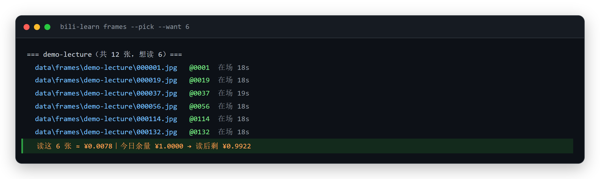
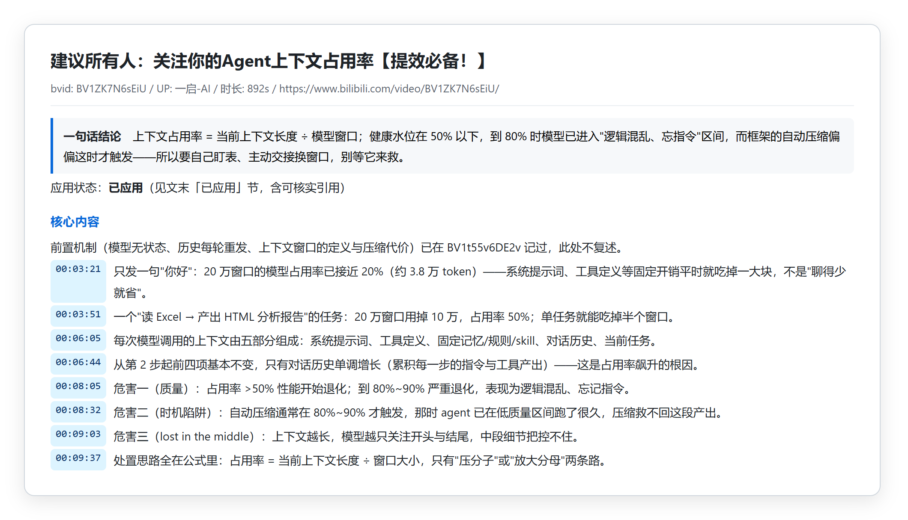

# bili-learn

> 把 B 站视频的**官方 AI 字幕**变成可检索的学习材料，并把**板书帧**按预算读进笔记里。
> 零依赖（只用 Node 内置模块 + 你机器上已有的 Chrome/Edge）、本地优先、**不调用任何模型**。

```
关键词 / 链接
   ↓  search / 你给链接
视频（bvid）
   ↓  transcript        ← 官方 AI 字幕（覆盖率会校验）
data/out/transcripts/<bvid>.md
   ↓  prompt            ← 生成"消化提示词"，交给你的 agent 或人
笔记（一句话结论 / 带时间戳的核心内容 / 可复用要点 / 术语 / 存疑）
   ↑  frames --pick     ← 板书帧按"在场时长"挑选 + 先算钱再读图
```





> 两张图都是**真实输出**，不是效果图：上面是 `frames --pick`，下面是它配套的笔记结构；
> 样例全文在 [`examples/`](examples/)。

## 它解决的问题

**视频里的知识，默认是留不下来的。** 你看完 40 分钟讲得挺好，一周后只剩"好像讲过什么"。
市面上两条路都不太好用：

| 方案 | 问题 |
|---|---|
| 自己记笔记 | 记的时候在暂停/回退，看完比看之前更累 |
| 语音转文字（Whisper 等） | 要下载模型、跑 CPU、还要处理口音与术语；40 分钟视频转录要十几分钟 |
| **官方字幕**（本工具） | B 站对绝大多数视频带 **AI 字幕轨**——已经是文本、带时间戳、免费、质量够用 |

本工具走第三条路，并且补上两个别人容易忽略的坑：**内容完整性校验**（字幕轨常常只覆盖前几分钟）
和**板书通道**（字幕只有声音，PPT/图表/代码只在画面里）。

## 快速开始

> **先登录**：未登录的干净 profile 会被 B 站风控拦下——连 `view`/字幕接口都返回 412
> （实测：指纹 cookie 已下发也照拒）。所以 `login` 不是可选项。

```powershell
git clone https://github.com/lcx03876-hue/bili-learn.git ; cd bili-learn
node bin/bili-learn.mjs doctor                 # 环境自检
node bin/bili-learn.mjs login                  # 扫码登录（登录态只存在本机 data/profile）
node bin/bili-learn.mjs search "机器学习 入门"  # 找视频
node bin/bili-learn.mjs transcript BV1ZK7N6sEiU
node bin/bili-learn.mjs prompt data/out/transcripts/BV1ZK7N6sEiU.md   # 生成消化提示词
```

需要 **Node >= 22**（用到内置 `WebSocket` + `fetch`）和 **Chrome 或 Edge**（不额外下载浏览器）。

> 已有别的 DSH/自动化 profile 且已登录？可以用环境变量复用它，不必重新扫码：
> `$env:BILI_LEARN_PROFILE='<已登录的 profile 目录>'; $env:BILI_LEARN_PORT='9444'`

## 本地仪表盘（可选）

转写攒多了以后，用 `dashboard/` 一眼看清家底：覆盖率分布、还没写笔记的视频、帧数与成本、一键导出报告。

它**只读**本地文件：不读 `data/profile`、不调 B 站接口、不发外部请求；唯一的写操作是往 `reports/` 导出报告。

```powershell
npm run dashboard      # 等价于 node dashboard/server.js
# 打开 http://127.0.0.1:8787
```

Windows 也可以直接双击 `dashboard/start.cmd`（会自己起服务并打开浏览器）。端口用 `PORT` 环境变量改。
细节、配置项与 API 见 [`dashboard/README.md`](dashboard/README.md)。

## 亮点（每条都对应一个坑，详见 `docs/FAILURE-MODES.md`）

1. **官方字幕优先，且校验覆盖率**——字幕轨可能只覆盖前 8 分钟，不校验就会"以为学完了"
2. **所有 B 站请求在页面内发出**——带登录态，绕开服务端直连的 412 反爬与 wbi 签名
3. **番剧/独家稿件自动识别**——它们会 302 到 `/bangumi/`，而**试看只有 6 分钟**（实测 `duration=360s`），
   播放器永远 `readyState=0`；识别到就跳过，不空等
4. **抓帧按画面变化抽，不整段录屏**——每 `intervalMs` 采一张 32×18 缩略图做差分，只有画面真的变了才存全分辨率图
5. **关键帧按"在场时长"挑**——一张画面停留越久越可能是完整板书；过渡帧在场极短，读它们纯属浪费
6. **读图前先算钱**——一张 1280×720 的 PPT 帧约 1300 token；额度不足**自动降级**，余量为 0 直接拒绝
7. **零依赖、不绑定模型**——工具只产出转写/关键帧/提示词，"消化"这一步交给你的 agent 或你本人
8. **本地优先**——登录态、字幕、抓帧、账本全在 `data/`，不上传任何地方

## 命令

| 命令 | 作用 |
|---|---|
| `doctor` | 环境自检（Node / 浏览器 / CDP / 数据目录 / 预算 / 账号账本） |
| `login` | 扫码登录，登录态存 `data/profile`（**不要把这个目录传出去**） |
| `search <关键词>` | 搜视频，列出 bvid / 时长 / 标题 |
| `transcript <bvid\|URL> [--p N]` | 取官方 AI 字幕 → `data/out/transcripts/*.md`，报告覆盖率 |
| `frames` | 列出已抓的帧目录（张数/体积） |
| `frames --dir <名字> --pick [--want N] [--book]` | 挑关键帧 + 算读图成本 + 检查预算 |
| `watch <bvid\|URL> [--rate 1.5] [--mute]` | 真实播放**并抓帧**到 `data/frames/<bvid>/`（⚠️ 见下方风险提示） |
| `prompt <transcript.md>` | 生成"消化提示词"，交给你的模型 |
| `spend [--add-yuan N] [--clear-vision]` | 本地账本：今天用了多少、撤掉读图占用 |

```powershell
# 读图闸门示例
node bin/bili-learn.mjs frames --dir BV1Vjug6yEeB --pick --want 6 --book
#   === BV13r95BFEXU（共 40 张，想读 6）===
#     路径…\000037.jpg   @0037  在场 19s
#     ...
#     读这 6 张 ≈ ¥0.0078｜今日余量 ¥1.0000 → 读后剩 ¥0.9922
node bin/bili-learn.mjs spend --clear-vision     # 读完撤销占用
```

## 配置 `data/config.json`

```jsonc
{
  "rate": 1.5,                 // 播放倍速（抓帧时用）
  "mute": true,
  "dailyBudgetYuan": 1,         // 每日预算：读图/消化都记在这个数下面
  "frames": {
    "intervalMs": 6000,          // 多久采一次缩略图做差分（键名与 src/frames.mjs 参数一致）
    "minGapMs": 8000,           // 两张之间最少隔多久（覆盖下限）
    "maxFrames": 40,            // 每条视频最多存几张
    "changeThreshold": 3,       // 画面变化阈值（越大越省）
    "visionTokensPerImage": 1300
  },
  "cost": { "priceInIdle": 1, "priceInPeak": 2, "priceOutIdle": 4, "priceOutPeak": 8 }
}
```

> 抓帧的**实际间隔会被自动放大到"铺满整条视频"**：`minGapMs = max(配置值, 时长÷maxFrames)`。
> 帧数与成本不变，覆盖从"开头 5 分钟"变成整条视频。核对：`frames --pick` 里每张的"在场"时长。

配置是**深合并**的：以后版本新增的键会对你已有的配置文件自动生效，你自己加的键也不会被删。
文件用**记事本编辑也没问题**（读取时会容忍 UTF-8 BOM——这一点很多工具都做错了，
BOM 会让 `JSON.parse` 抛错，然后"回退默认值"就把你的配置悄悄重置了；见
[`FAILURE-MODES.md`](docs/FAILURE-MODES.md) 第 19、20 条）。

## 它**不做**什么（重要）

- **不做语音识别**。没有字幕轨的视频（部分直播回放、无 CC 的老视频）会明确告诉你"没字幕"，不会硬转。
  如果你需要覆盖这些，自己接 Whisper——但先看看官方字幕能覆盖你多少目标视频。
- **不调用任何 LLM**。`prompt` 只产出文本，成本由你自己的模型决定。
- **不自动发评论/点赞/投币**。这类动作脚本化违反平台协议、且对别人没有复用价值。
- **不承诺画质/完整性**：字幕覆盖率会如实报告，低于 80% 会在文件头打 ⚠️。

## ⚠️ 风险与合规提示（请务必读完）

- **自动化播放**属于 B 站用户协议的灰区。本工具的 `watch` 是给"抓帧/生成转写"服务的，
  请用**低频、可见、合理间隔**的方式使用；不要拿它刷观看时长或播放量——那是另一码事，也是被封号的最快路径。
- **登录态**（`data/profile/`）等于你的账号凭据，**不要提交、不要分享、不要放到云同步目录**。
- 本工具**只读取公开可访问的字幕轨**，不做接口签名逆向；但它依然是自动化访问，请自行评估账号风险。
- 本仓库的实测数据来自个人账号与单机环境，**换账号/换地区可能不同**；`docs/MEASUREMENTS.md` 给了复现脚本。

## 文档

| 文件 | 内容 |
|---|---|
| [`docs/FAILURE-MODES.md`](docs/FAILURE-MODES.md) | **踩坑表**：十几个失败模式的现象 → 原因 → 修法（这个项目最值钱的部分） |
| [`docs/COST-ENGINEERING.md`](docs/COST-ENGINEERING.md) | 成本工程：双轨记账、预算闸门、自动降级 |
| [`docs/MEASUREMENTS.md`](docs/MEASUREMENTS.md) | 实测数据与复现方法（分区可用率 / 字幕覆盖率 / 上下文开销 / 缓存命中） |
| [`examples/`](examples/) | 一段真实字幕 + 一篇真实笔记 |
| [`tools/render-readme.mjs`](tools/render-readme.mjs) | 重画本 README 的两张配图（`npm run readme:images`）：真跑 CLI 取输出 → HTML 卡片 → headless 截图 |

## License

MIT
