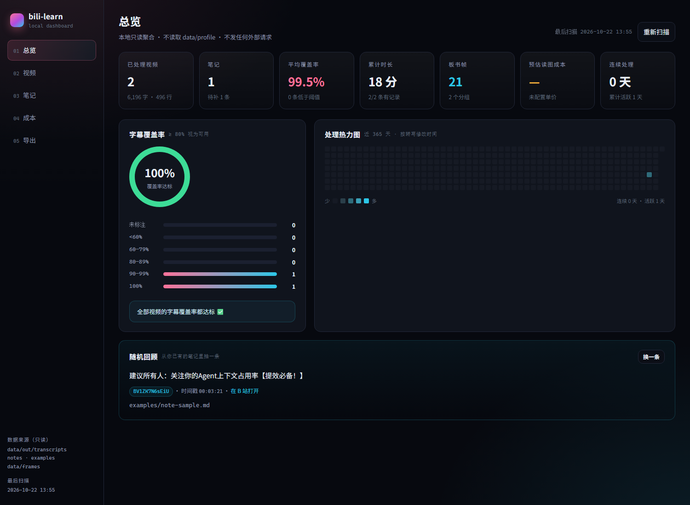

# bili-learn dashboard（本地只读学习仪表盘）

把仓库里已经沉淀的数据（转写、笔记、板书帧）聚合成一个本地网页：看清处理了多少、覆盖率如何、还欠多少笔记、帧与成本大概是什么量级。



- **零依赖**：只用 Node 内置 `http` / `fs` / `path` / `url`，前端是原生 HTML/CSS/JS，不引 CDN。
- **只读**：唯一的写操作是「导出报告」，只写 `reports/`，且**只新建不覆盖**。
- **不碰账号**：不读 `data/profile/`，不调任何 B 站接口，不发任何外部网络请求。
- **不改核心**：CLI、转录、抓帧、prompt 生成逻辑一行没动；本目录是独立外挂层。

## 启动

```bash
cd bili-learn
node dashboard/server.js
# → http://127.0.0.1:8787
```

环境变量：

| 变量 | 默认 | 说明 |
|---|---|---|
| `PORT` | `8787` | 端口 |
| `HOST` | `127.0.0.1` | 绑定地址；默认只给本机访问，不建议改 |
| `DASHBOARD_CONFIG` | `dashboard/dashboard.config.json` | 指定另一份配置文件（自检/多数据源时用） |
| `DASHBOARD_LOG` | 开 | 设为 `0` 关掉每条请求的访问日志 |

## 数据来源（全部只读）

| 数据 | 默认路径 | 解析方式 |
|---|---|---|
| 转写 | `data/out/transcripts/*.md` | 读文件头：`# 标题`、`- bvid:`、`- UP:`、`- 时长: 892s`、`- 字幕覆盖: 99%`；低于 80% 或带 ⚠️ 记为不完整；正文按 `[hh:mm:ss]` 行统计字数/行数 |
| 笔记 | `notes/`、`examples/`（可配置多个） | 递归扫 `.md`（跳过 `README.md`），从正文里取 BV 号、`#标签`、首个时间戳 |
| 板书帧 | `data/frames/<分组>/*.jpg|png|webp` | 按子目录分组计数；目录名里能识别出 BV 就自动关联 |
| 单价 | `dashboard/costs.json`（可选） | `yuanPerFrame`，或 `yuanPer1kTokens` + `tokensPerFrame`；**没配就不估算金额** |
| 手工成本 | `dashboard/manual-costs.json`（可选） | 数组或对象，按 `date`/`month` + `yuan` 聚合到月 |
| 报告 | `reports/` | 导出目标；页面会列出历史报告 |

仓库目前的真实样本：2 份转写（`BV1Vjug6yEeB`、`BV1ZK7N6sEiU`）、2 个帧分组（`BV1Vjug6yEeB` 9 张、`demo-lecture` 12 张）、1 篇笔记（`examples/note-sample.md`）。

## 配置（可选）

复制 `dashboard/dashboard.config.example.json` 为 `dashboard/dashboard.config.json` 后按需改：

```jsonc
{
  "transcriptsDir": "data/out/transcripts",
  "framesDir": "data/frames",
  "notesDirs": ["notes", "examples"],       // 笔记可以放多个目录，支持绝对路径
  "reportsDir": "reports",
  "costsFile": "dashboard/costs.json",
  "manualCostsFile": "dashboard/manual-costs.json",
  "lowCoverageThreshold": 0.8,
  "tagPattern": "#[\\p{L}\\p{N}_-]{1,24}",
  "ignoreDirs": ["node_modules", ".git", "data/profile"],
  "maxFileBytes": 4194304,
  "maxNoteDepth": 8,
  "scanCacheMs": 1500
}
```

配置缺失或 JSON 损坏时**回退默认值**并在页面顶部提示，不会崩。

## 成本视图怎么用

1. 不建 `costs.json`：页面只显示帧数，金额位置明确写「未配置单价，不估算金额」。
2. 建 `dashboard/costs.json`（照 `costs.example.json`）：

```json
{ "yuanPerFrame": 0.002, "currency": "CNY" }
```

   或按 token：

```json
{ "yuanPer1kTokens": 0.001, "tokensPerFrame": 1300 }
```

3. 手工账本 `dashboard/manual-costs.json`：

```json
[
  { "date": "2026-10-01", "yuan": 1.2, "note": "读图 600 张" },
  { "date": "2026-10-15", "yuan": 0.8 }
]
```

仪表盘只做**乘法**：帧数 × 你给的单价。没有单价就绝不显示金额。

## 页面

- **总览**：视频/笔记/覆盖率/帧/成本/连续天数六张卡；覆盖率环图 + 分布条；近 365 天热力图；随机回顾一条笔记（带 BV 与时间戳直达链接）。
- **视频**：按 BV / 标题 / UP 搜索，按修改时间、覆盖率、标题、字数排序；低覆盖率打 ⚠️。
- **笔记**：笔记总数、周趋势、标签云；「有转写但无笔记」待办表；全部笔记列表（含本地路径）。
- **成本**：帧总数与分组、单价配置状态、按月手工成本。
- **导出**：生成 Markdown + HTML，写入 `reports/`。

## HTTP API

| 方法 | 路径 | 作用 |
|---|---|---|
| GET | `/api/health` | 存活检查 |
| GET | `/api/meta` | 配置、数据源路径、告警 |
| GET | `/api/stats` | 总览统计（含分布、热力图、待办） |
| GET | `/api/videos?q=&sort=mtime\|coverage\|title\|chars&order=desc` | 视频列表 |
| GET | `/api/notes?q=` | 笔记 + 标签 + 趋势 + 待办 |
| GET | `/api/costs` | 帧数、单价配置、手工成本 |
| GET | `/api/reports` | `reports/` 里已有的报告 |
| POST | `/api/export` | 生成报告，返回写入路径 |

返回统一为 `{ ok: true, data }` / `{ ok: false, error: { code, message } }`。

## 安全边界

- 默认只绑定 `127.0.0.1`，没有鉴权，**不要暴露到公网**。
- 所有扫描路径来自配置文件，**不来自 HTTP 参数**；静态资源走 `safeRelative()` + `safeJoin()` 双重校验，拒绝 `..`、反斜杠穿越、`%2e%2e`。
- `data/profile/`（登录态）在 `ignoreDirs` 里，扫描器永远不会进入；代码里没有任何 B 站域名或 fetch 到外部的调用。
- 导出用 `flag: 'wx'`（存在即失败）写文件，保证不覆盖任何已有文件；报告只落在 `reports/`。
- 除 `reports/` 外没有 `writeFile` / `unlink` / `rename` 调用。

## 已知限制

- **覆盖率只认文件头**：老转写如果没有 `- 字幕覆盖:` 行，会显示「未标注」，不会推算。
- **笔记靠 BV 关联**：笔记里没写 BV 就进不了「已有笔记」，会一直躺在待办里。
- **帧分组不一定是 BV**：`demo-lecture` 这种自定义目录名会计入帧数，但关联不到视频。
- **时长只在有 `- 时长:` 时有**：缺失时总时长卡片显示「—」，不做估算。
- **热力图按本地时区**取转写文件的 mtime。
- 扫描是每次请求现算（1.5 秒内存缓存），数据量很大时首屏会慢一点；没有做增量索引。

## 自检

```bash
cd bili-learn
node --check dashboard/server.js
PORT=8899 node dashboard/server.js &
curl -s localhost:8899/api/health
curl -s localhost:8899/api/stats | head -c 400
curl -s -X POST localhost:8899/api/export
ls reports/
```

用仓库现有数据应看到：`scope.videos = 2`、`scope.notes = 1`、`frames.total = 21`、`todoCount = 1`（BV1Vjug6yEeB 没有笔记）、`distribution` 里 `90–99%` 与 `100%` 各 1。
